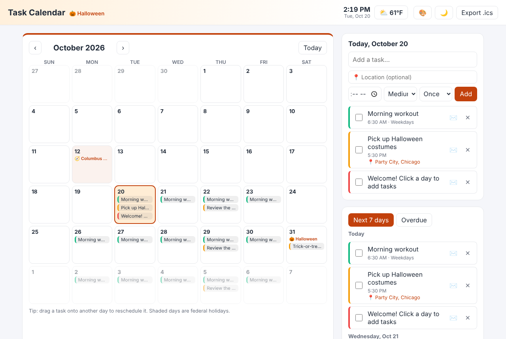
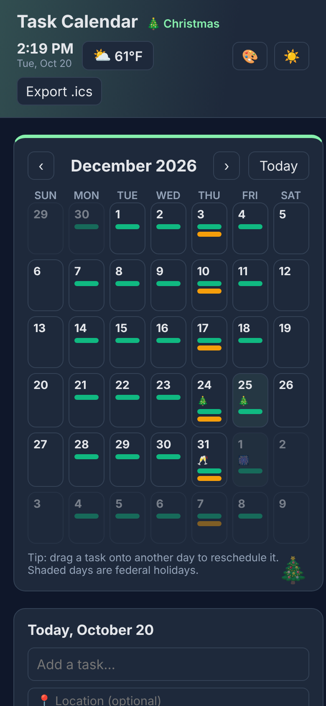

# Task Calendar

**▶ [Live demo](https://theoyanvno.github.io/task-calendar/)**

A to-do list and a calendar in one. Plan tasks on a month view, check them off, set them to repeat, drag them to a new day, and export everything to your phone's calendar. US holidays are built in, each month gets a holiday theme, and the top corner shows the time and your local weather.

**Tech:** JavaScript (ES modules) · HTML/CSS · Drag and Drop API · Geolocation API · Open-Meteo REST API · `localStorage` · iCalendar (.ics) · `node:test` · no frameworks

| Desktop | Phone, dark mode |
|---|---|
|  |  |

## Features

- **Month calendar** with color-coded task chips on each day (red = high, amber = medium, green = low priority)
- **Day panel**: click any day to see its tasks and add new ones with an optional time, priority and repeat rule
- **Repeating tasks**: daily, weekdays, weekly or monthly. Monthly tasks on the 31st land on the last day of shorter months. Checking off a repeating task completes only that day.
- **Drag and drop** a one-time task onto another day to reschedule it
- **Next 7 days** and **Overdue** views, with an overdue badge
- **Export .ics** to import your tasks (including repeat rules and locations) into Google Calendar, Apple Calendar or Outlook
- **US holidays**: all 11 federal holidays, computed for any year (Thanksgiving is the 4th Thursday of November, Memorial Day the last Monday of May…), with the observed Friday or Monday when one falls on a weekend. Also Easter, Mother's and Father's Day, Valentine's, St. Patrick's, Halloween, Christmas Eve and more. Federal holidays are shaded.
- **A theme for every month** based on its big holiday: New Year's in January, Valentine's in February, St. Patrick's in March, Easter in April, Mother's Day in May, Juneteenth in June, the Fourth of July, summer break in August, Labor Day in September, Halloween in October, Thanksgiving in November and Christmas in December. It follows the month you're looking at, works in dark mode, and can be turned off with 🎨. A test checks that every theme's colors pass the WCAG AA contrast ratio.
- **Time and weather** in the top corner: a live clock and the current temperature and conditions for your location (with permission) or any city you type ("Springfield, IL" picks the right Springfield), in °F or °C. Weather comes from [Open-Meteo](https://open-meteo.com/) (free, no API key) and refreshes every 15 minutes.
- **Task locations**: add a place to any task; it shows under the task with a 📍 link that opens Google Maps
- **Email reminders**: ✉️ next to a task opens it in Google Calendar, already filled in (time, location, repeat rule). Save it and Google emails you before it's due, even with this page closed. The site is static, with no server to send email, so Google Calendar does the sending. One-time setup: in Google Calendar, *Settings → Settings for my calendars →* your calendar *→ Event notifications → Add notification → Email*.
- Dark mode (follows your system setting, with a toggle), works on phones, and saves automatically in your browser

## How it works

| File | What it does |
|---|---|
| [`src/tasks.js`](src/tasks.js) | Pure date and task logic: month grid, repeat rules, sorting, overdue/upcoming, completion, iCalendar export |
| [`src/holidays.js`](src/holidays.js) | US holidays for any year: nth-weekday rules, the Easter algorithm and weekend observed days |
| [`src/themes.js`](src/themes.js) | The 12 monthly holiday themes and a contrast checker |
| [`src/weather.js`](src/weather.js) | Weather codes to emoji, Open-Meteo URLs, picking the right city from search results |
| [`src/app.js`](src/app.js) | Rendering, adding and completing tasks, drag and drop, views, themes, clock and weather, and saving |

Dates are stored as `YYYY-MM-DD` strings in local time, which avoids the classic bug where a task shifts a day because of time zones.

## Run it

```bash
python3 -m http.server 8000      # then open http://localhost:8000
npm test                         # 21 tests: dates and repeats, holidays, themes, weather, Google Calendar links
```

Built with help from AI coding tools for planning, code review and tests.
